# 幾徳祭予約システム 

2026-10-22 時点の仕様。本番(11/7・8までは「準備中」と表示): [https://fes.kaitedtc.com](https://fes.kaitedtc.com)

受付に置いた共用端末（iPad/PC/SUNMI V1s）で予約を受け、お客さんは自分のスマホやPCで空き状況だけを見られるWebアプリ。予約は予約番号と人数だけで管理し、名前や連絡先は一切預からない。開催は2日間で、受付期間は運用開始から終了までとする。

あおぬまくんのSUNMI V1sとの連携前に設計したため、SUNMI V1sの仕様は入れてないことに注意してほしい。

## 1. 用語

| 用語   | 意味                                             |
| ---- | ---------------------------------------------- |
| 体験   | おしながきの3つ（プログラミング体験・ぶるぶるくん・相撲ロボット）         |
| コマ   | 予約の単位となる時間帯。体験・開始・終了時刻と定員を持つ                  |
| 予約   | 1つのコマに人数分の枠を確保すること                             |
| 予約番号 | 予約を見分けるための4文字のランダムな英数字（例: K7P2）。お客さんの名前の代わりに使う |
| 受付端末 | こちらで用意し、管理画面で登録したiPad/PC。予約はこの端末からしかできない       |

## 2. ロール

ロールは3つ。予約する場所（受付端末）と設定する場所（管理画面）を分け、お客さんの端末は見るだけにしている。

| ロール                 | 使う端末                   | できること                             | ログイン                     |
| ------------------- | ---------------------- | --------------------------------- | ------------------------ |
| 閲覧者（お客さん）           | 自分のスマホ・PC              | 体験の紹介・空き状況・お知らせ・予約のしかたを見る       | 不要                       |
| 受付端末の操作者（お客さん/メンバー） | 登録済みのiPad/PC/SUNMI V1s | 予約を作る（取消はできない）                    | 不要（端末の登録だけ）              |
| 管理者（メンバー）           | 任意                     | コマ・全体設定、予約一覧、代理予約・取消、受付端末の登録、操作ログ | 共有の管理者アカウント（認証アプリの6桁コード） |

受付端末では、誰が操作しているかを区別しない。お客さん本人が操作しても、メンバーが代わりに操作しても、画面と手順は同じになる。

## 3. 運用フロー

### 開催前の準備

1. 管理画面の「全体設定」（/admin/settings）で受付期間（開催2日間）、1予約の最大人数、お知らせを設定する
2. 「カレンダー」（/admin/calendar）で開催日を開き、「コマを追加」で体験・開始・終了時刻と定員を入れて、その日のコマを作る。体験ごと・2日分それぞれで行う
3. 受付用の iPad/PC で /admin にログインし、「受付端末」（/admin/devices）で「この端末を登録」を押す。ログアウトしてから /kiosk を開く
4. iPad はアクセスガイド、PC はブラウザのキオスクモードで、予約画面以外を操作できないようにする
5. 運用を始めるときに、全体設定の「公開する」をオンにする。オフの間、公開ページの体験の紹介は出るが、空き状況は「準備中」と表示され、お知らせも出ない（管理画面と登録済みの受付端末はオフでも使える）

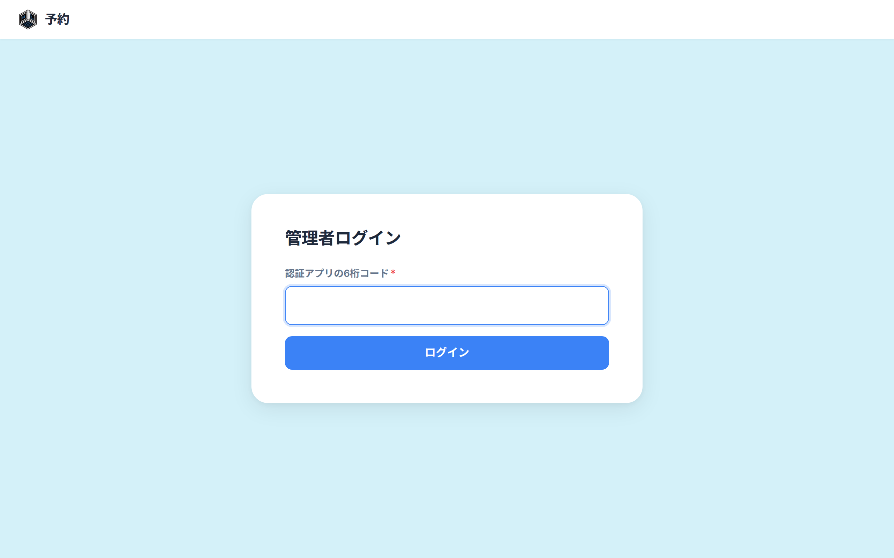

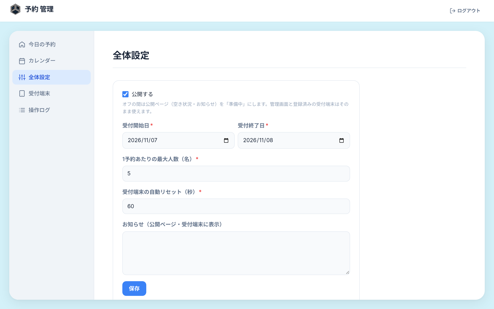

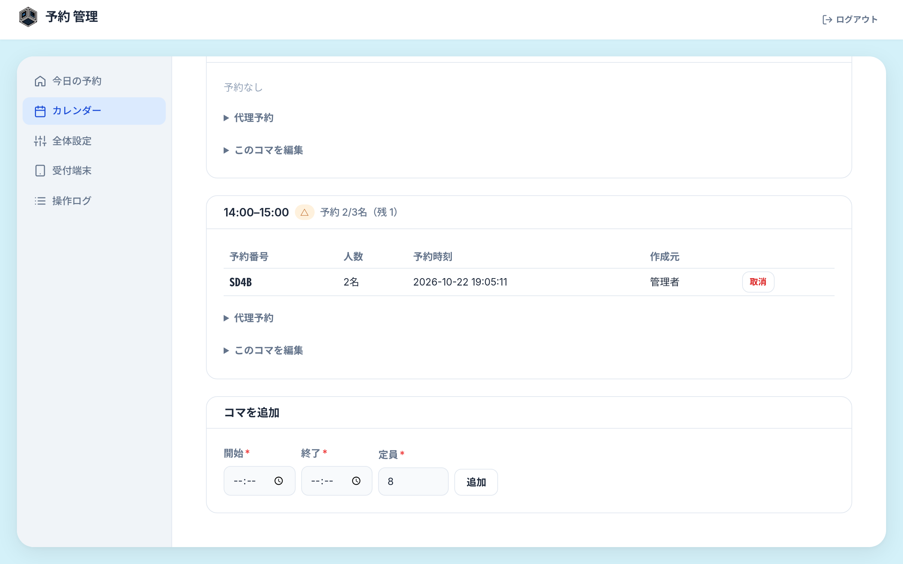

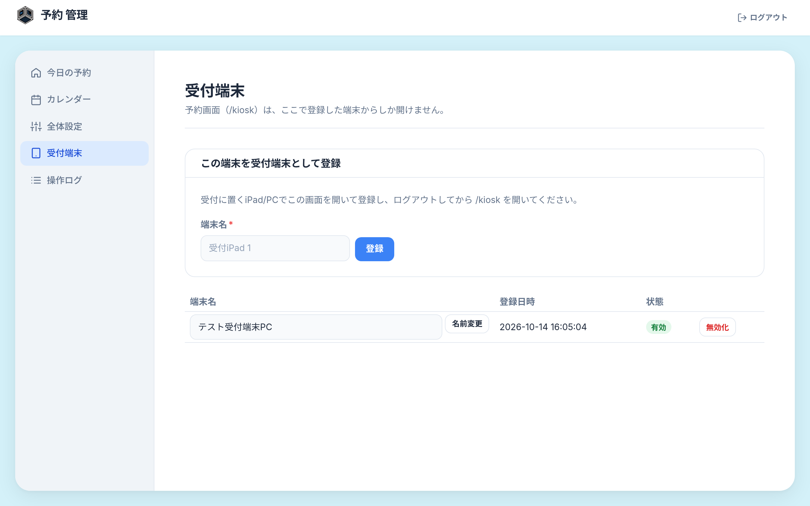

### 受付端末での予約

1. 日付を選ぶ（受付期間内で、今日以降の日付だけが出る）
2. 体験とコマを選ぶ（体験ごとにコマが並ぶ。満員・終了したコマは選べない）
3. 人数を選ぶ（1〜最大人数のボタン）
4. 内容を確認して確定する（確認画面には「戻る」がある）
5. 予約番号・体験・日時・人数が大きく表示される。スマホがあるお客さんには画面を撮影してもらい、ない人にはメンバーが予約番号・体験・日時・人数を紙に書いて渡す
6. 一定時間（初期値60秒）たつと自動でトップに戻る。操作が止まったときも同じ時間でトップに戻り、前の人の入力は残らない

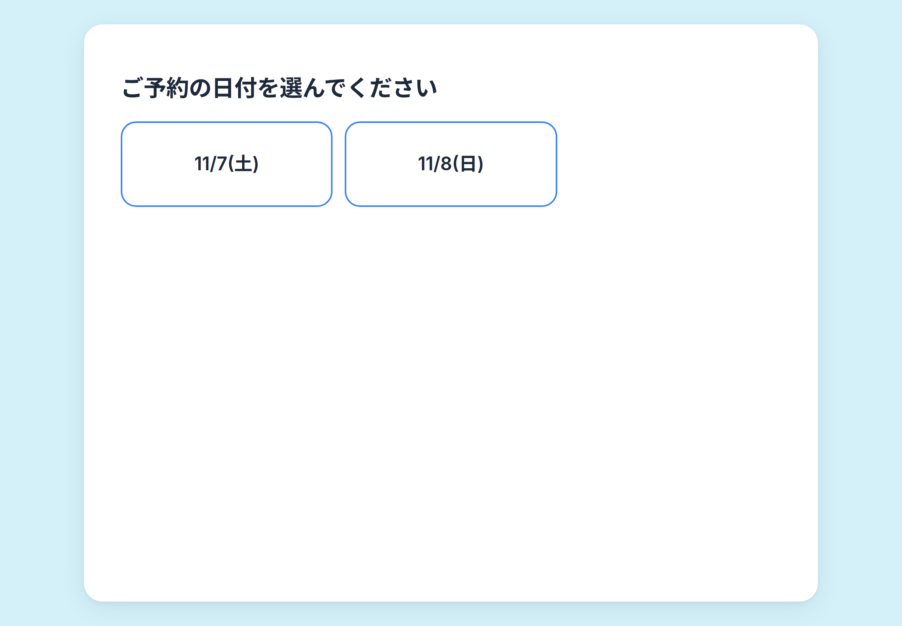

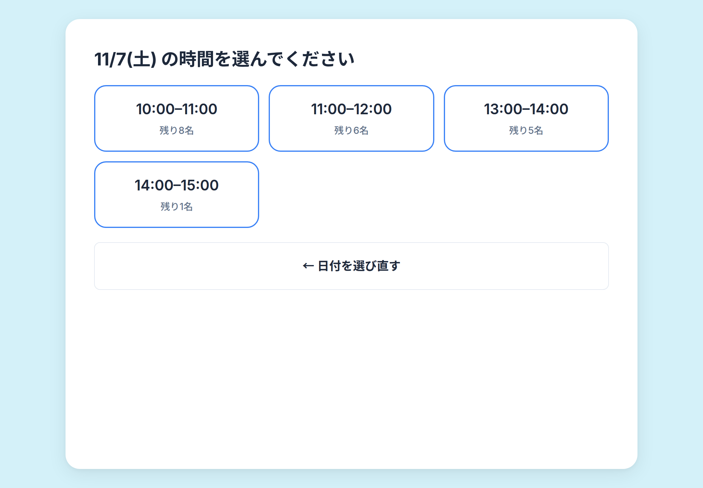

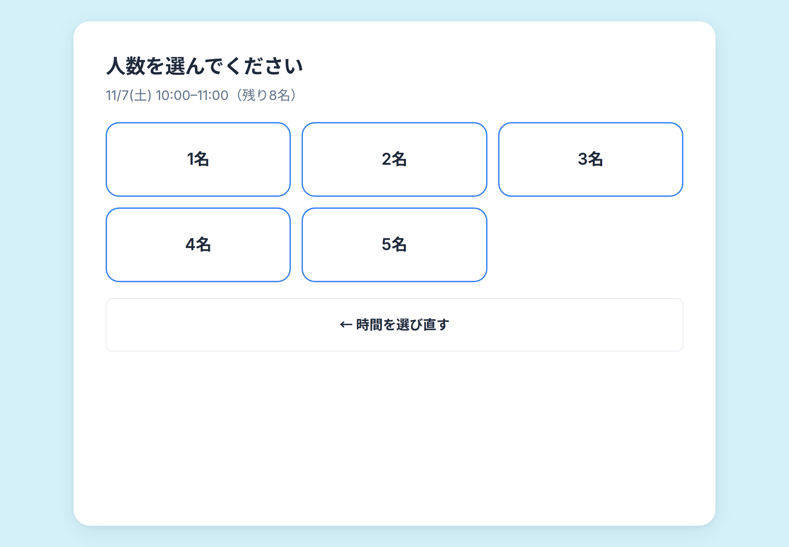

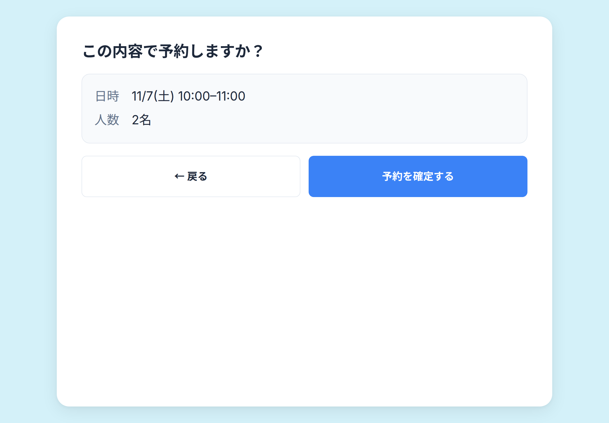

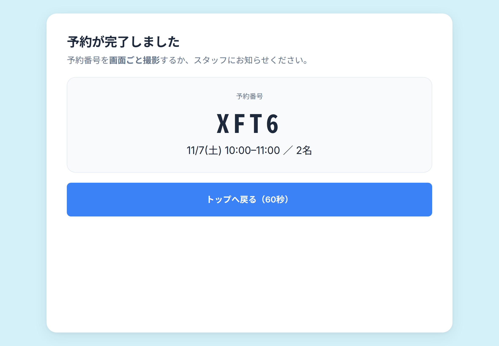

お客さんは自分のスマホで、トップページの各体験の「空き状況を見る」から同じ空き状況を見られる。

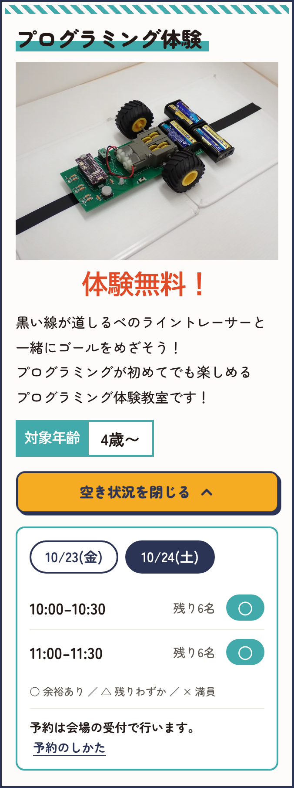

### 取消・変更の依頼

お客さんから予約番号を聞き、管理者が管理画面で予約番号を検索して取消する。変更は取消してから取り直す。予約番号をなくした人は、日付・コマ・人数・予約した時刻から管理者が予約を探して取消する。

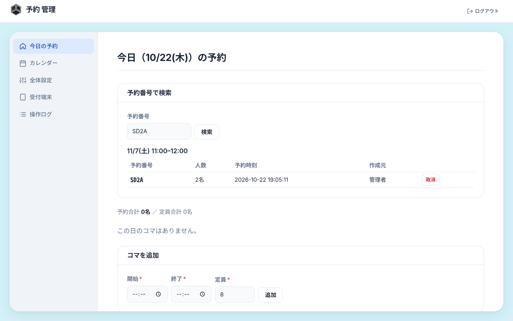

### 当日の照合

お客さんに予約番号を口頭で伝えてもらい、管理画面の「今日の予約」（/admin）の一覧と照らし合わせる。

### 友達などの優遇予約(念のため笑)

管理者が管理画面から代理予約で登録する。代理予約は受付期間外や開始済みのコマにも入れられる。定員を超える予約は「定員超過を許可」にチェックしたときだけ登録できる。

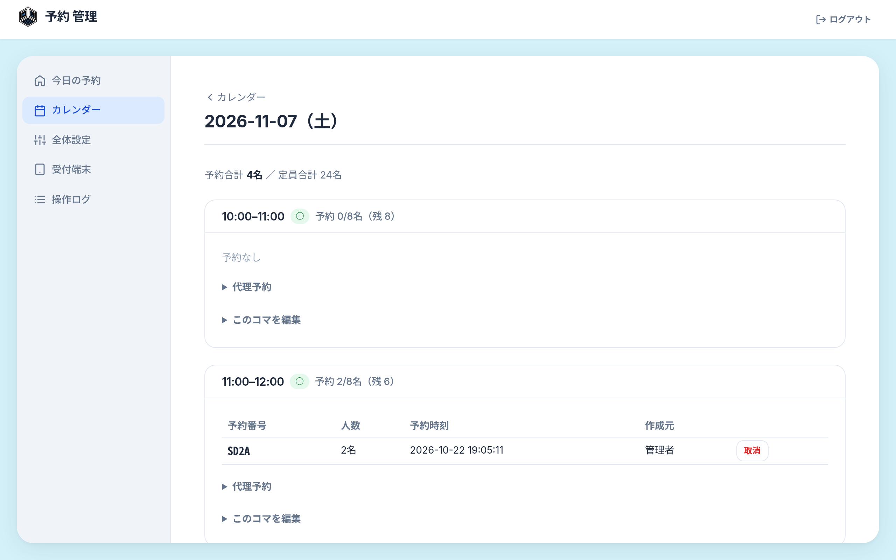

### システムが止まったとき

紙で受付を続け、復旧後に管理者が代理予約で登録し直す。

### 端末をなくしたとき

管理画面の「受付端末」で、その端末をすぐに無効にする。

## 4. 画面と機能

### 公開ページ（お客さん向け）

| 画面      | URL        | 内容                                                            |
| ------- | ---------- | ------------------------------------------------------------- |
| トップ     | /          | 1ページにまとめた公開ページ。ポスター（メカデミー）の内容、会場の地図と時間、おしながき（体験ごとの説明・対象年齢・料金）、お知らせ、予約のしかた |
| 空き状況    | / の各体験    | 体験ごとの「空き状況を見る」で開く。日付ごとのコマと状態（○ 余裕 / △ 残りわずか / × 満員 / 終了 / 受付停止）。予約はできない（見るだけ） |
| 以前のURL   | /day/:date /guide /news | トップ（/guide は予約のしかた、/news はお知らせの位置）へ転送する                     |

### 受付端末

| 画面         | URL                  | 内容                                          |
| ---------- | -------------------- | ------------------------------------------- |
| 日付選択       | /kiosk               | 受付期間内の日付を大きなボタンで出す                          |
| コマ選択       | /kiosk/:date         | 体験ごとに分けた、残数つきのコマ一覧。選べないコマはグレーで出す         |
| 人数選択・確認・完了 | /kiosk/:date/:slotId | 人数ボタン、内容の確認、確定。確定後に予約番号を出し、カウントダウンのあとトップへ戻る |

- 2台の受付端末が同じコマの最後の枠を同時に確定しても、定員は超えない（確定のときに残数をもう一度確かめる）
- 確定ボタンは1回押すと押せなくなり、同じ予約が二重に登録されない
- 登録していない端末で /kiosk を開くと、公開ページに戻される
- 受付端末の画面には管理画面への入口を置かない

### 管理画面

管理画面は /admin にあり、受付端末や公開ページからはリンクしていない。  
アクセス頻度が少ないこと・導線が多くなりすぎることを防ぐため'/admin'をタイプすることでのみアクセス可能。

| 画面    | URL             | 内容                                                 |
| ----- | --------------- | -------------------------------------------------- |
| ログイン  | /admin/login    | 認証アプリの6桁コードでログインする                                 |
| 今日の予約 | /admin          | 今日のコマごとの予約番号・人数・残数。予約番号での検索                        |
| カレンダー | /admin/calendar | 月の表示。日ごとにコマの追加（体験を選ぶ）・編集・削除、代理予約、予約の取消           |
| 全体設定  | /admin/settings | 公開スイッチ、受付期間、1予約の最大人数（初期値5名）、自動リセットの秒数（初期値60秒）、お知らせ |
| 認証アプリ | /admin/otp      | 認証アプリの追加・再発行                                       |
| 受付端末  | /admin/devices  | 端末の登録・名前の変更・無効化                                    |
| 操作ログ  | /admin/logs     | いつ、どの端末や管理者が、何をしたか（予約、取消、設定の変更、ログインなど）             |

## 5. 確定事項

設計の段階で決めたこと。

**お客さんの情報を保持しないこと**だけは遵守してほしい。

### やること

- 予約は受付端末からだけ受け付ける。手順は「日付 → 体験とコマ → 人数 → 確認」の4ステップに限る
- 予約の取消は、管理者が管理画面からだけ行う
- 予約番号は4文字の英数字で、見間違えやすい文字（0とO、1とIとL）は使わない
- 定員を超える予約は作らない。例外は、管理者が「定員超過を許可」にチェックした代理予約だけ
- 予約の締切は設けない。開始時刻を過ぎたコマは予約できなくなり、公開ページでは「終了」と出す
- 1予約あたりの最大人数は初期値5名とし、管理画面で変えられる
- 定員を減らしたりコマを削除したりしても、すでに入っている予約は消さない。定員を下回った分は画面に「定員超過」と出し、必要なら管理者が1件ずつ取消する
- 1コマだけ受付を止めたいときは、定員を今の予約人数まで下げる（満員になる）か、予約がなければコマを削除する
- 管理者アカウントはメンバーで共有する1つだけとし、ログインには認証アプリの6桁コードを使う。メンバー全員が同じQRコードを自分の認証アプリに登録する
- ログインに15分間で10回失敗すると、ログインを一時的に止める
- 運用を始めるまでは公開スイッチをオフにし、公開ページを「準備中」にしておく
- 中止や変更は、公開ページのお知らせ（トップの一番上）で伝える
- 時刻はすべて日本時間で扱う

### やらないこと

- 名前・電話番号・メールアドレスなど、個人を特定できる情報は入力させず、保存もしない
- 自由に文字を入力する欄は作らない（メモ欄があると名前や電話番号が書き込まれるため）。入力はすべて選択式にする
- アプリのログに、IPアドレスや端末の詳細を残さない
- お客さん自身のスマホやPCからは予約させない（見るだけ）
- 受付端末では予約の取消をさせない
- 料金の管理やオンライン決済は扱わない
- メールやLINEでの通知はしない
- 会員の管理はしない
- 受付端末で、誰が操作しているかを区別しない

### 個人情報を持たないことで起きる制約

| 制約                          | 対処                                |
| --------------------------- | --------------------------------- |
| 中止や変更をお客さんに個別に連絡できない        | 公開ページのお知らせで告知する。お客さんには来場前に確認してもらう |
| 予約番号をなくすと、取消を頼まれても予約を特定しにくい | 管理者が日付・コマ・人数・予約した時刻から予約を探して取消する   |
| 当日の本人確認ができない                | 予約番号を口頭で伝えてもらい、予約一覧と照らし合わせる       |
| 同じ人が何度も予約するのを防げない           | 1予約あたりの最大人数で上限をかける。目立つようなら運用で対応する |
